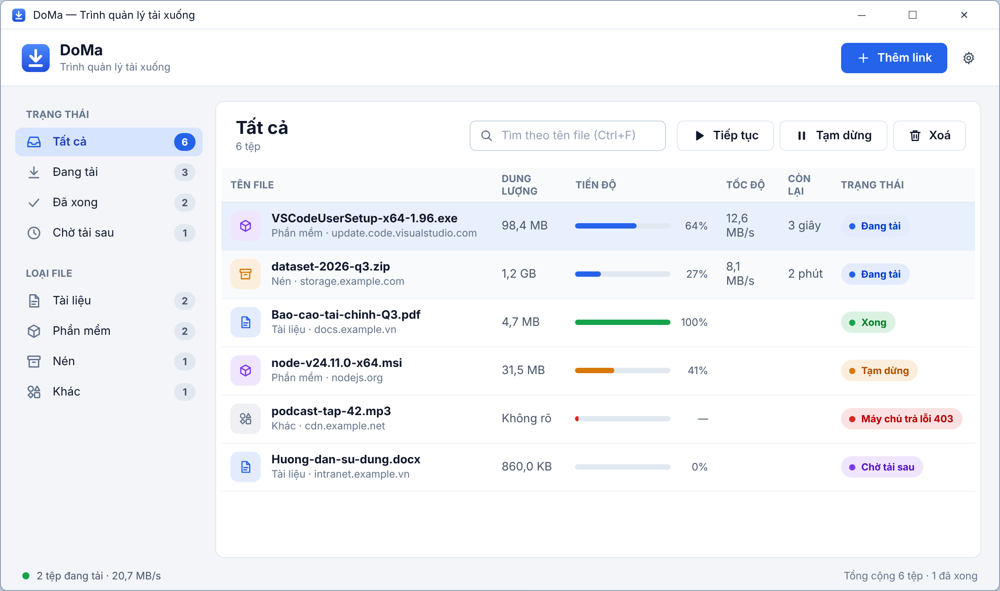

  

<h1 align="center">DoMa — Download Manager</h1>

  Trình quản lý tải xuống nhẹ, an toàn cho Windows. Bắt lượt tải từ Chrome/Edge, tải nhiều luồng, tải tiếp khi bị ngắt và tự cập nhật.

  
  
  

---

## Tính năng

- **Bắt lượt tải từ trình duyệt.** Bấm tải trên Chrome hoặc Edge, DoMa nhận link ngay, kèm cookie, referer và user-agent, nên tải được cả link cần đăng nhập hoặc link có token hết hạn.
- **Tải nhanh, nhiều kết nối.** Mỗi file được chia đoạn và tải song song (mặc định 16 kết nối, chỉnh được từ 1 đến 32).
- **Tải tiếp khi bị ngắt.** Mất mạng, tắt app hay tắt máy đều tải tiếp được (khi máy chủ hỗ trợ `Range`).
- **Tự phân loại.** File được xếp vào thư mục `TaiLieu`, `PhanMem`, `Nen` hoặc `Khac` theo đuôi file. Bạn tự chỉnh danh sách đuôi được.
- **Tải ngay hoặc Tải sau.** Mỗi lượt tải có hộp xác nhận để đổi tên hoặc nơi lưu, hoặc để dành vào hàng chờ.
- **Chạy ngầm dưới khay hệ thống**, có thông báo khi tải xong hoặc lỗi, và có thể khởi động cùng Windows.
- **Tự động cập nhật** cả ứng dụng lẫn tiện ích trình duyệt (xem [bên dưới](#tự-động-cập-nhật)).
- **Nhẹ và minh bạch.** Không kèm runtime hay thư viện bên thứ ba, không mở cổng mạng, và tiện ích không chạy script trên trang web.

## Cài đặt

1. Cài [.NET 10 Desktop Runtime](https://dotnet.microsoft.com/download/dotnet/10.0) (bản x64) nếu máy chưa có.
2. Tải `DoMa-Setup-x.y.z.exe` ở trang [Releases](https://github.com/tdhieu94/download-manager/releases/latest) rồi chạy. Bộ cài không cần quyền quản trị.
3. Cài tiện ích cho trình duyệt:
   - Mở `chrome://extensions` (Chrome) hoặc `edge://extensions` (Edge).
   - Bật **Developer mode** (Chế độ dành cho nhà phát triển).
   - Bấm **Load unpacked** và chọn thư mục `%LOCALAPPDATA%\Programs\DoMa\extension`.

> Đừng xoá hay di chuyển thư mục `extension`, vì trình duyệt cần nó để chạy tiện ích.

## Sử dụng

| Thao tác | Cách làm |
|---|---|
| Tải từ trình duyệt | Bấm tải như bình thường, DoMa sẽ hiện hộp **Tải xuống mới** |
| Thêm link thủ công | Nút **Thêm link** hoặc `Ctrl+N` (link trong clipboard được dán sẵn) |
| Tìm file | `Ctrl+F` |
| Mở file đã tải | Nhấp đúp hoặc `Enter` |
| Xoá | Nút **Xoá** hoặc phím `Delete` (chọn xoá cả file trên ổ đĩa hay không) |
| Tiếp tục / Tạm dừng / Tải lại / Mở thư mục / Copy link | Thanh công cụ hoặc chuột phải vào dòng |
| Cài đặt | Biểu tượng bánh răng ở góc trên bên phải |

Bấm nút đóng cửa sổ chỉ ẩn DoMa xuống khay. Muốn thoát hẳn, bạn chuột phải vào biểu tượng ở khay và chọn **Thoát**.

## Tự động cập nhật

- DoMa kiểm tra [Releases](https://github.com/tdhieu94/download-manager/releases) khi mở và cứ 6 giờ một lần. Bạn cũng có thể chọn **Kiểm tra cập nhật** ở menu khay.
- Khi có bản mới, cửa sổ chính hiện dải thông báo **Cập nhật ngay**. DoMa sẽ tải bộ cài, đối chiếu mã **SHA-256**, cài im lặng, tự mở lại và tải tiếp các file đang dở.
- Tiện ích trình duyệt tự nạp lại khi thấy DoMa có phiên bản mới hơn, bạn không cần khởi động lại trình duyệt.
- Bạn tắt được việc tự kiểm tra trong **Cài đặt → Hệ thống**.

## Dữ liệu và quyền riêng tư

- Dữ liệu nằm ở `%LOCALAPPDATA%\DoMa`: cài đặt, danh sách tải và nhật ký lỗi.
- Cookie của từng lượt tải được mã hoá bằng Windows DPAPI (chỉ tài khoản Windows của bạn giải mã được) và bị xoá khi tải xong.
- Nhật ký lỗi tự lược bỏ phần query của URL (token, chữ ký…).
- DoMa chỉ kết nối tới máy chủ của file bạn tải và tới `api.github.com` để kiểm tra bản cập nhật.
